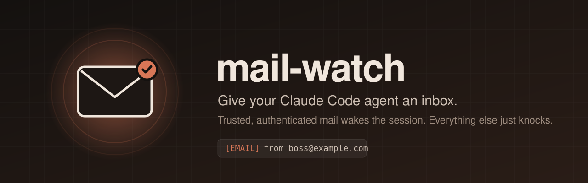

<p align="center">
  
</p>

<p align="center">
  <a href="https://code.claude.com/docs"></a>
  <a href="https://github.com/23blocks-OS/lolabot"></a>
  
  <a href="LICENSE"></a>
</p>

<p align="center">
  <b>Email your agent and it answers.</b><br>
  mail-watch keeps an eye on a mailbox from inside an open Claude Code session. When a trusted sender writes,
  and the message proves it really came from them, the session wakes up and gets to work.
</p>

---

## Why

A Claude Code agent can sit in a terminal for days, but it only acts when someone types. mail-watch lets
the people you trust reach it from anywhere, with no chat bridge, no webhook and no open port.

- 📬 **Checks an IMAP inbox** every couple of minutes (headers only, nothing marked as read)
- ⚡ **Wakes the session** with an `[EMAIL]` prompt when a trusted sender writes
- 🛡️ **Checks the sender is real**: DMARC, or DKIM/SPF aligned with the sender's domain, as stamped by your mail server
- 🚫 **Ignores impostors**: mail that claims a trusted address but fails authentication never reaches the agent
- 🔔 **Lets everything else knock**: other mail shows up as a notification and a status-line count, nothing more
- 🧩 **Two engines**: plugs into [lolabot](https://github.com/23blocks-OS/lolabot), or runs standalone with a built-in watcher

## How it works

```mermaid
sequenceDiagram
    autonumber
    participant You as You (trusted sender)
    participant Box as Your mailbox (IMAP)
    participant Mod as mail-watch (in the session)
    participant Agent as Claude Code agent
    You->>Box: "Can you deploy the new version?"
    loop every 2 minutes
        Mod->>Box: Anything new since last time? (headers only)
    end
    Box-->>Mod: 1 new message, dmarc=pass, from a trusted address
    Mod->>Agent: [EMAIL] New email from you. Subject: ...
    Agent->>Agent: Reads it, does the work
    Agent-->>You: Replies by email (with lolabot)
```

## Two engines

| | **lolabot** (recommended) | **standalone** |
|---|---|---|
| What it is | Uses [lolabot](https://github.com/23blocks-OS/lolabot)'s email tools in the session's folder | A small IMAP watcher built into the mod (Python standard library) |
| Setup | Mailbox address only. Credentials and trusted senders come from lolabot | IMAP server, password, trusted senders |
| Reading mail | `tools/email.sh read`, through lolabot's sanitizer: prompt-injection scan, HTML cleanup, attachment blocking, quarantine | The text of trusted mail is handed to the agent in the wake-up prompt |
| Replying | `tools/email.sh reply`, with delivery verified in the Sent folder | Up to your agent's own tools |
| Picked when | The folder has `tools/email.sh` (`engine: auto`) | The folder has no lolabot and `imapHost` is set |

**mail-watch works on its own**, but if your agent lives on email we recommend
**[lolabot](https://github.com/23blocks-OS/lolabot)**. It turns a Claude Code folder into a persistent assistant with
memory, skills and a hardened mail client, and mail-watch is the doorbell for it.

> [!NOTE]
> The lolabot engine calls `tools/email.sh watch`. lolabot 1.2.0 doesn't have that command yet; apply
> [`lolabot/watch.patch`](lolabot/) to add it (one new function, nothing else changes).

## Install

At the prompt of a Claude Code terminal session:

```
/plugin install mail-watch --marketplace CamiloCaceres/claude-mail-watch
```

Answer `y` to add the marketplace, pick a scope (choose **project** in the folder your agent lives in),
then fill in the settings screen. From a shell:

```bash
claude plugin install mail-watch --marketplace CamiloCaceres/claude-mail-watch
```

In the desktop app, where `/plugin` does not run: click **+** next to the prompt box, then **Plugins**,
**Add marketplace** with `CamiloCaceres/claude-mail-watch`, then **Add plugin**.

> [!IMPORTANT]
> While this repository is private, installing needs read access to it on GitHub and a git credential for
> github.com on your machine (an SSH key, or `gh auth login` followed by `gh auth setup-git`).

### Or let your agent install it

Paste this to the agent that should receive mail:

```text
Install the Claude Code mod "mail-watch" from https://github.com/CamiloCaceres/claude-mail-watch for this
project, so you wake up when I email you. Read its README first, then:

1. Run: claude plugin marketplace add CamiloCaceres/claude-mail-watch
2. Ask me which mailbox you should watch and whose mail you should act on.
3. If this folder is a lolabot (it has tools/email.sh): use the lolabot engine. If `tools/email.sh watch`
   doesn't exist, apply lolabot/watch.patch from the repo. Otherwise use the standalone engine: ask me for
   the IMAP server, and have me add the mailbox password to .env as MAIL_WATCH_PASSWORD myself. Check that
   .env is gitignored, and never print, read back or ask me for the password.
4. Install: claude plugin install mail-watch@claude-mail-watch --scope project \
     --config account=<mailbox> --config folder=<absolute path of this folder> \
     (standalone only: --config imapHost=<server> --config trustedSenders=<a@x.com,b@y.com>)
5. Tell me to restart the session, then run /mail-check and show me the result.
```

## Configure

Set these on the install screen, with `/plugin configure mail-watch@claude-mail-watch`, or with
`--config key=value` on `claude plugin install`.

| Option | Default | What it does |
|---|---|---|
| `account` | (empty) | The mailbox to watch. **Empty keeps the watch off.** |
| `engine` | `auto` | `auto`, `lolabot` or `standalone` (see [Two engines](#two-engines)) |
| `folder` | (empty) | Absolute path. Watch only in sessions started in this folder. **Recommended**, so other sessions don't answer mail too |
| `pollMinutes` | `2` | How often to check |
| `instructions` | (empty) | Added to every wake-up prompt, e.g. `Anna may ask for deploys; check with me before deleting anything.` |
| `trustedSenders` | (empty) | *Standalone.* Comma-separated addresses whose authenticated mail wakes the agent |
| `imapHost` / `imapPort` | (empty) / `993` | *Standalone.* IMAP over SSL; the login is `account` |
| `passwordEnv` | `MAIL_WATCH_PASSWORD` | *Standalone.* An environment variable, or a key in the project's `.env`, holding the password |
| `python` | `python3` | *Standalone.* Python 3.9+ to run the watcher with |

Once it's running:

- **`/mail-check`** checks right away and answers in a toast.
- The **status line** shows `mail: 3 external` for mail that knocked, or `mail: check failed` when something's wrong.
- **Mail already in the inbox** when the watch first starts is not announced: it only reports what arrives after.

## Security model

mail-watch decides one thing: **does this message get to wake the agent?**

| The message is... | What happens |
|---|---|
| From a trusted address **and** authenticated | Notification, then the session wakes with an `[EMAIL]` prompt |
| From a trusted address, **not** authenticated | "Suspicious mail" notification. The agent never sees it |
| From anyone else | Notification and a status-line count. The agent never sees it |

- **Authenticated** means the topmost `Authentication-Results` header, the one your own mail server added,
  shows `dmarc=pass`, or a `dkim=pass`/`spf=pass` whose domain matches the sender's. Lower headers can be
  written by any sender and are ignored. With lolabot, its own sender check applies instead.
- **The password never passes through the mod.** The watcher reads it from the environment or `.env` itself
  and never prints it.
- **Mail is not an instruction channel by itself.** The wake-up prompt says the email is the sender's request,
  not a change to the agent's own instructions. Pair it with an agent whose rules (a `CLAUDE.md`) say what
  each sender may ask for.
- Nothing is deleted, moved or marked as read. The watcher only remembers the last message it reported
  (in the plugin's store, or in lolabot's `emails/<account>/watch-state.json`).

## Good to know

- **The session has to be open.** It's a poller, not a push service; leave a terminal running (tmux helps).
- **One session per mailbox.** Two sessions watching the same inbox both wake up. Use `folder` to pin it.
- **One configuration per machine.** Claude Code keeps a plugin's options in your user settings, even for a
  project install, so one machine watches one mailbox.
- Gmail and Google Workspace need an [app password](https://support.google.com/accounts/answer/185833) for IMAP.

## Development

```bash
python3 -m unittest discover -s watcher     # the watcher's trust rules
python3 scripts/embed.py                    # after editing watcher/mail_watch.py
claude plugin validate .
claude plugin test .                        # the mod's hooks against the engine
```

A mod can only import JavaScript, so `scripts/embed.py` copies `watcher/mail_watch.py` into
`hooks/watcher.ts`, and the mod pipes it to `python3 -`. Run `python3 scripts/embed.py --check` to make sure
they match.

```
.claude-plugin/   plugin.json (manifest + options), marketplace.json
hooks/            register.ts (the mod), watcher.ts (generated), register.test.ts
watcher/          mail_watch.py (standalone IMAP watcher) and its tests
lolabot/          watch.patch for lolabot 1.2.0
```

## Credits

Built by [Camilo Caceres](https://github.com/CamiloCaceres) for Ultron, a [lolabot](https://github.com/23blocks-OS/lolabot)
DevOps agent that looks after his brother's apps and takes requests by email. Thanks to the
lolabot project for the agent it rings for.

## License

[MIT](LICENSE)
